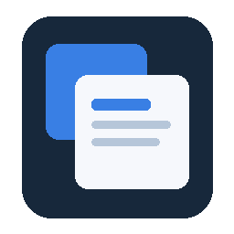

# Library Card · v0.5.0



Zentrale Vorlagenbibliothek für Home Assistant: Karten einmal gestalten und an
mehreren Stellen verknüpft verwenden. Änderungen an der Vorlage aktualisieren
alle Verwendungen; lokale Ausnahmen bleiben erhalten.

This custom integration provides reusable Lovelace card templates, shared
settings and local exceptions. Original card editors and Bubble Card popups are
used without bundling or replacing those integrations.

## Funktionen

- HA-Karten, installierte Custom Cards und vollständige Stacks speichern.
- Originale grafische Karteneditoren und direkte YAML-Eingabe verwenden.
- Alles, markiertes Design oder einzelne Felder aus der Vorlage übernehmen.
- Personenfarben und andere gemeinsame Werte zentral verknüpfen.
- Lokale Entitäten, Styles und `card_mod` als Ausnahmen festlegen.
- Bubble-Popups direkt per Hash-Button öffnen, ohne zusätzliche Dashboard-Karte.
- Mehrere eigene Hash-Verknüpfungen mit lokalen Änderungen je Vorlage speichern.
- Vorlagen importieren/exportieren, Verlauf ansehen und Stände wiederherstellen.

## Installation mit HACS

Das Repository ist erst nach Annahme des HACS-Antrags im Standardkatalog.
Bis dahin in HACS unter **Benutzerdefinierte Repositories**
`https://github.com/Baeka89/library-card` als **Integration** hinzufügen.

[In HACS öffnen](https://my.home-assistant.io/redirect/hacs_repository/?owner=Baeka89&repository=library-card&category=integration)

1. Library Card mit HACS herunterladen und Home Assistant neu starten.
2. **Einstellungen → Geräte & Dienste → Integration hinzufügen → Library Card**.
3. Erweiterten Modus im Benutzerprofil aktivieren. Unter
   **Einstellungen → Dashboards → ⋮ → Ressourcen** ein JavaScript-Modul hinzufügen:
   `/card_library/card-library.js?v=0.5.0`.
4. Browser neu laden. Über **Karte hinzufügen → Kartenbibliothek** Vorlagen verwalten.
5. Für normale Dashboard-Karten eine **Vorlagenkarte** einsetzen und Vorlage wählen.
   Für Popups ausschließlich den öffnenden Button verwenden.

Manuell: `custom_components/card_library` nach
`/config/custom_components/card_library` kopieren, danach dieselben Schritte.
Beim Update Programmdateien ersetzen; die Bibliothek bleibt in `.storage`.

## Eine Vorlage erstellen

In **Konfiguration → Vorlage hinzufügen** eine Karte wählen, vorhandene
Dashboard-Karte übernehmen oder ihre vollständige YAML einfügen. Im Originaleditor
bearbeiten und **Zentrale Änderungen speichern** drücken.

Unter **Vorlagen einsetzen** die gespeicherte Vorlage auswählen. **Örtliche
Anpassungen** ändern nur diese Verwendung. Unveränderte Werte bleiben verknüpft.
Für normale Karten anschließend das Dashboard speichern.

## Popups

Ein vollständiges Bubble-Popup behält seinen zentralen Hash, etwa `#Menu`.
Unter **Als Bubble-Popup verwenden** wird dieser zusammen mit Button-Code angezeigt.
Unter **Eigene Popup-Verknüpfung** lassen sich etwa `#Menu-Wohnzimmer` und
`#Menu-Flur` mit verschiedenen lokalen Einstellungen speichern.

```yaml
type: button
name: Menü öffnen
tap_action:
  action: navigate
  navigation_path: '#Menu-Wohnzimmer'
```

Nur der Button liegt auf dem Zieldashboard. Die Bibliotheksressource verbindet
sich im Hintergrund mit der Integration und lädt die passende Vorlage.
Die Konfigurationskarte muss dort nicht gespeichert werden.

[Popup-Anleitung](BUBBLE-POPUPS.md) · [Weitere Bedienhinweise](docs/USAGE.md)

## Voraussetzungen und Grenzen

- Home Assistant ab 2024.7.0 stellt die verwendete statische HTTP-API bereit.
- Custom Cards müssen separat installiert und als Ressourcen geladen sein.
- Grafische Bearbeitung setzt einen Editor des jeweiligen Kartentyps voraus.
- Bubble-Popups benötigen Bubble Card mit Standalone-Popups, ab 3.2.0.
- `card_mod` benötigt card-mod; kartenspezifische Styles benötigen Unterstützung
  durch die jeweilige Karte. Die Bibliothek übergibt deren Konfiguration.
- Administratoren verwalten zentrale Vorlagen und Hash-Verknüpfungen.
- Zentrale Bindungen können nicht lokal überschrieben werden.
- Bibliothek und aufgelöste Karten sind auf je 2 MB begrenzt.
- Nicht gespeicherte Strategie-Dashboards oder eigenständige Bildschirmschoner
  können nicht vollständig übernommen werden.

Alle angemeldeten HA-Benutzer können die Bibliothek lesen. Vorlagen sind kein
geschützter Speicher für Zugangsdaten. Der Prüfstand und seine Grenzen stehen in
[Tests](docs/TESTS.md). Für beliebige Custom Cards wird keine universelle
Kompatibilität behauptet.

## Entwicklung und Veröffentlichung

GitHub-Metadaten werden beim ersten Start von `publish.py` personalisiert.
Für GitHub und den HACS-Antrag siehe [Veröffentlichen](docs/PUBLISH.md) und
[HACS-Prüfbericht](docs/HACS-AUDIT.md).

```bash
python -m pip install -r requirements-dev.txt
npm test
python -m unittest discover -s tests -p 'test_*.py' -v
python tests/check_websocket_schemas.py
```

MIT-Lizenz. Externe Karten bleiben unter ihren jeweiligen eigenen Lizenzen.
